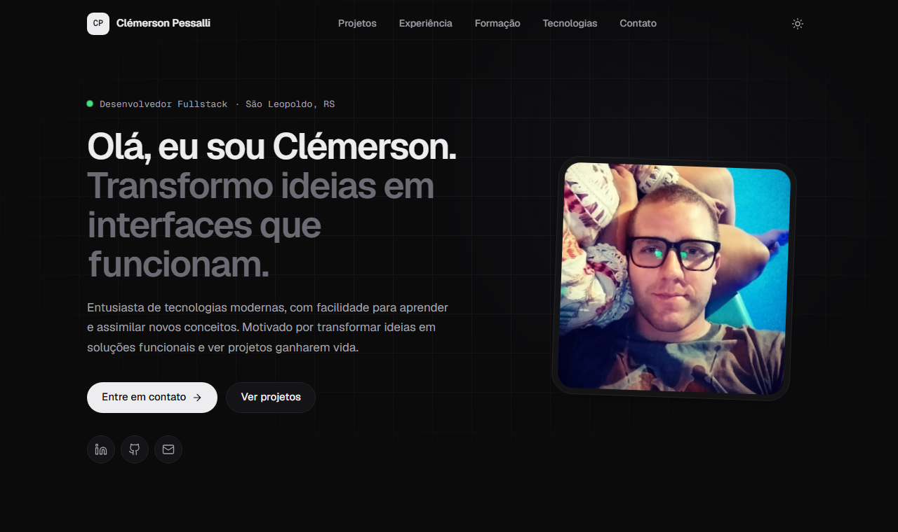

# 👨‍💻 Clémerson B. Pessalli | Portfólio

[](https://clemersonbp.github.io)
[](https://developer.mozilla.org/pt-BR/docs/Web/HTML)
[](https://developer.mozilla.org/pt-BR/docs/Web/CSS)
[](https://developer.mozilla.org/pt-BR/docs/Web/JavaScript)

Site pessoal e portfólio profissional desenvolvido com HTML, CSS e JavaScript puro.



## ✨ Funcionalidades

- 🌓 **Tema claro/escuro** - Segue o sistema, com escolha manual persistida no localStorage e sem "flash" ao carregar
- 📱 **Design responsivo** - Adaptável a qualquer tamanho de tela, com menu mobile acessível
- ⚡ **Performance otimizada** - Sem dependências de JavaScript externas; ícones SVG embutidos
- 🎨 **UI minimalista** - Tipografia Geist, animações de entrada suaves (respeitando `prefers-reduced-motion`)
- 🧭 **Navegação fluida** - Header que destaca a seção atual e botão para copiar o e-mail

## 🛠️ Tecnologias Utilizadas

- **HTML5** - Estrutura semântica
- **CSS3** - Estilização com CSS Variables e Flexbox/Grid
- **JavaScript** - Interatividade e funcionalidades
- **[Lucide Icons](https://lucide.dev/)** - Ícones (embutidos como SVG)
- **[Google Fonts](https://fonts.google.com/)** - Tipografia Geist e Geist Mono

## 📂 Estrutura do Projeto

```
clemersonbp.github.io/
├── index.html          # Página principal
├── css/
│   └── styles.css      # Estilos do site
├── js/
│   └── scripts.js      # Scripts de interatividade
└── assets/
    └── img/            # Imagens do projeto
        └── projetos/   # Capturas de tela dos projetos
```

## 📄 Seções do Site

- **Início** - Apresentação pessoal
- **Projetos** - [BladesPro](https://bladespro.com.br) e [My Baby List](https://mybabylist.cloud), produtos em produção
- **Experiência** - Trajetória profissional
- **Formação** - Formação acadêmica
- **Tecnologias** - Stack de desenvolvimento
- **Contato** - Informações de contato

## 📝 Licença

Este projeto está sob a licença MIT. Sinta-se à vontade para usar como referência ou inspiração.

---

<p align="center">
  Desenvolvido com 💜 por <a href="https://github.com/clemersonbp">Clémerson B. Pessalli</a>
</p>
